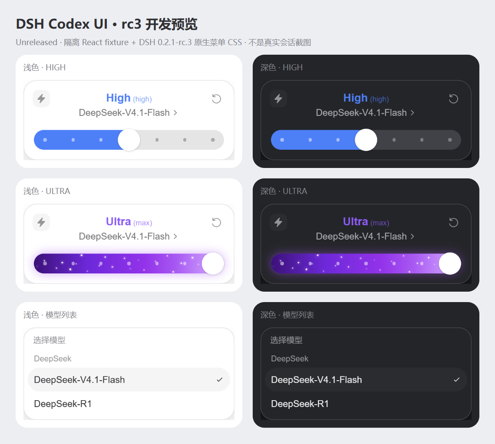

# dsh-codex-ui 1.2.1

DeepSeek Harness 的 Codex 风格模型与推理等级弹窗。独立发行名为 `dsh-codex-ui`，基于 [Microqian2th/dsh-codex-effort-slider](https://github.com/Microqian2th/dsh-codex-effort-slider) 的 `d1bb67b20bc19d44be7d7694ffca92a6f2fcbe9b`（1.1.2）修改。上游版权与 MIT 许可证完整保留，见 [THIRD_PARTY_NOTICES.md](THIRD_PARTY_NOTICES.md)。



上图为当前开发分支的隔离预览，尚未发布到 npm；固定版本 `1.2.1` 不包含这些后续调整。历史发行截图见 [1.2.0 总览](preview/screenshots/v1.2.0/overview.png)。

## 三种原生安装方式

在 DSH「插件」页选择「安装第三方插件」，按来源填入以下任一项。三种方式安装的是同一个插件，选择一种即可。首次公开发布状态与维护者操作见 [PUBLISHING.md](PUBLISHING.md)。

| 来源 | 输入内容 |
| --- | --- |
| npm | `dsh-codex-ui@1.2.1` |
| Git 仓库 | `https://github.com/chadqian2012-sudo/dsh-codex-ui.git#v1.2.1` |
| 本地目录 | 解压后直接包含 `package.json` 的文件夹绝对路径，例如 `D:\Plugins\dsh-codex-ui` |

**1.2.1 已发布。** 此版本修复拖动时的指针身份、捕获丢失结算与取消清理问题。当前开发分支中的后续修复尚未发布，见 [CHANGELOG.md](CHANGELOG.md) 的 Unreleased 条目；固定版本安装不会包含这些后续改动。既往下载验收范围见 [PUBLISHING.md](PUBLISHING.md) 与 [VALIDATION.md](VALIDATION.md)。

npm 下载源优先选择「npm 官方源」`https://registry.npmjs.org/`；需要时可选择镜像源 `https://registry.npmmirror.com/`，新版本可能尚未同步。Git 和本地目录来源无需配置 npm 包的下载源。本仓库的 `.npmrc` 仅为当前项目指定官方源，不改变全局配置。

**已有旧版 `dsh-codex-effort-slider` 时，先在 DSH 插件页卸载旧版，再安装此独立发行版。** 两个插件装饰同一个菜单，应只保留一个启用。安装器也会拒绝在旧版仍注册时叠加安装。更新同名第三方插件时，当前 DSH 要求先卸载再安装；先结束当前推理，再按 DSH 的提示重新启动。具体步骤、CLI 和离线回滚见 [INSTALL.md](INSTALL.md)。

## 界面与星尘

- 界面整体按原尺寸的 90% 缩放：卡片约 342×130px，档位标题 18px、模型名称 15px、图标 18px；滑轨厚 32px，圆形旋钮直径 36px。
- 卡片、滑轨各层与旋钮明确使用圆角，覆盖 DSH 全局 `corner-shape: superellipse(1.5)` 样式。
- 模型列表使用 DSH 真实名称、版本、分组和原生选择事件。
- 左侧闪电显示推理状态；右侧重置由 DSH 解析当前模型的默认 effort。
- 七个显示档位映射到 DeepSeek 的四个真实 effort ID：Off (`off`)、Low (`low`)、Medium (`low`)、High (`high`)、XHigh (`high`)、Max (`max`)、Ultra (`max`)。显示名称描述界面档位，不表示彼此的质量等价关系。
- Off 为静态灰色，Low 至 Max 五档保持静态蓝色。滑块从 Max 移向 Ultra 的最后六分之一行程时，紫色渐变与星尘按 smoothstep 淡入；回退时平滑淡出。Ultra 的星尘约 3 秒横穿一次，闪电开启后约 1.7 秒，速度比为 1.8 倍且相位连续；各粒子保留窄幅速度差。蓝色区域开启闪电后显示灰色星尘。
- 闪电为实心图标与浅灰圆角底座，无悬停提示。开启时模型名称渐隐，短暂显示“使用额度消耗更快”，再渐隐并恢复原生模型入口；关闭时直接恢复，不再播放该文字。此文案按用户指定展示，闪电功能只改变动效，不改变模型请求、推理强度或实际额度。
- 保留原滑块运动引擎与完整／简洁／快速动画模式，右键滑条可打开原有设置。

星尘采用每组件独立的积分相位时钟。变速影响后续位移，切换档位时不会重新排列星星；保留确定性分布、亮度与速度差，避免逐帧 React 重渲染。关闭弹窗或卸载时停止帧循环。旧版滑条偏好键沿用，因此迁移后可保留同一浏览器配置中的动画偏好。

## 会话边界与兼容性

宿主入口仅检查客户端产物；客户端只装饰当前 composer 通过 `aria-controls` 关联的模型菜单。模型和 effort 在用户操作控件后通过官方模型目录接口更新。没有消息注入、会话事件钩子、提示词改写、请求拦截或模型适配器修改。目录不可用或菜单结构不匹配时保留原生界面；不同会话使用各自的缓存、提交队列与粒子相位。

已核对的运行时为 DSH `0.2.1-rc.2` 和 `0.2.1-rc.3`。本轮 rc3 验证使用安装包的菜单／目录静态契约与原生 CSS 的隔离浏览器 fixture，包含模型搜索、空结果及窄屏布局；没有重复执行真实会话发送测试。RC 阶段不声明 `engines.dsh`，避免标准 semver 的预发布匹配规则提前拒绝其他 RC；这不表示已验证所有 DSH 版本。支持 Desktop 与 Web，界面依赖宿主的模型菜单契约，结构不匹配时保留原生菜单。源码已包含 `lib/` 产物，npm、Git、本地安装均无需编译，也没有安装生命周期脚本或运行时依赖。

## 开发与验证

需要 Node.js 22 或更高版本。开发依赖只用于测试，不进入运行时依赖树。

```powershell
npm ci --ignore-scripts
npm test
npm run test:asar
npm run test:distribution
npm run test:install
npm run test:publish
npm run test:zip
npm run test:native
npm run test:browser
npm run preview
node test/capture-ui-refinement.mjs
npm run pack
```

基础测试与发行工件测试不需要 DSH 或模型账号。`test:native`、`test:browser` 和预览读取本机 DSH 的官方 CSS／菜单契约；可用 `DSH_APP_ASAR` 指定 `app.asar`，用 `BROWSER_EXECUTABLE` 指定 Chromium 程序。浏览器目录替身不连接真实会话或调用模型。完整验证范围见 [VALIDATION.md](VALIDATION.md)。

## English

**Version 1.2.1 is published.** It fixes pointer identity, lost capture settlement, and cancellation cleanup during slider drags. Follow-up fixes on the development branch remain unreleased; see the Unreleased section in [CHANGELOG.md](CHANGELOG.md). Pinned release installs do not contain those changes. See [PUBLISHING.md](PUBLISHING.md) and [VALIDATION.md](VALIDATION.md) for historical verification. DSH `0.2.1-rc.2` and `0.2.1-rc.3` have verified menu contracts; the rc3 checks use the installed package and a React fixture with its native CSS, including searchable and empty model lists, without new real-conversation tests; no `engines.dsh` gate is declared during the RC phase, so other prereleases are not rejected solely by semver. This does not claim that all DSH versions have been tested.

Codex-style model and effort menus for DeepSeek Harness, distributed independently as `dsh-codex-ui`. The seven display tiers map to the four actual DeepSeek effort IDs: Off (`off`), Low (`low`), Medium (`low`), High (`high`), XHigh (`high`), Max (`max`) and Ultra (`max`); display labels do not claim quality equivalence. The interface is scaled to 90% of its original size, with an approximately 342×130px card, 18px tier heading, 15px model name, 18px icons, a 32px track and a 36px circular knob. Explicit rounded corners on the track layers and knob override DSH's global `corner-shape: superellipse(1.5)`. Off stays gray; Low through Max stay blue. During the final sixth of slider travel from Max to Ultra, the purple gradient and stardust fade in with smoothstep; they fade out smoothly on retreat. Ultra particles traverse the track in about 3 seconds, or about 1.7 seconds with the visual-only boost enabled, preserving the 1.8x speed ratio and phase continuity. Gray dust in the blue region keeps its previous speed. Enabling the lightning fades the model name out, briefly shows the requested Chinese notice, then restores the native model entry; disabling it cancels that notice. The lightning has no hover tooltip. The notice does not change actual requests or quota behavior. The lightning control uses a solid SVG on a light-gray rounded base. Remove the upstream `dsh-codex-effort-slider` first. Install from npm, the tagged Git repository, or an absolute local package directory after confirming the chosen source is available. The package ships prebuilt JavaScript with no runtime dependencies or install scripts. Original MIT copyright and attribution are retained.
