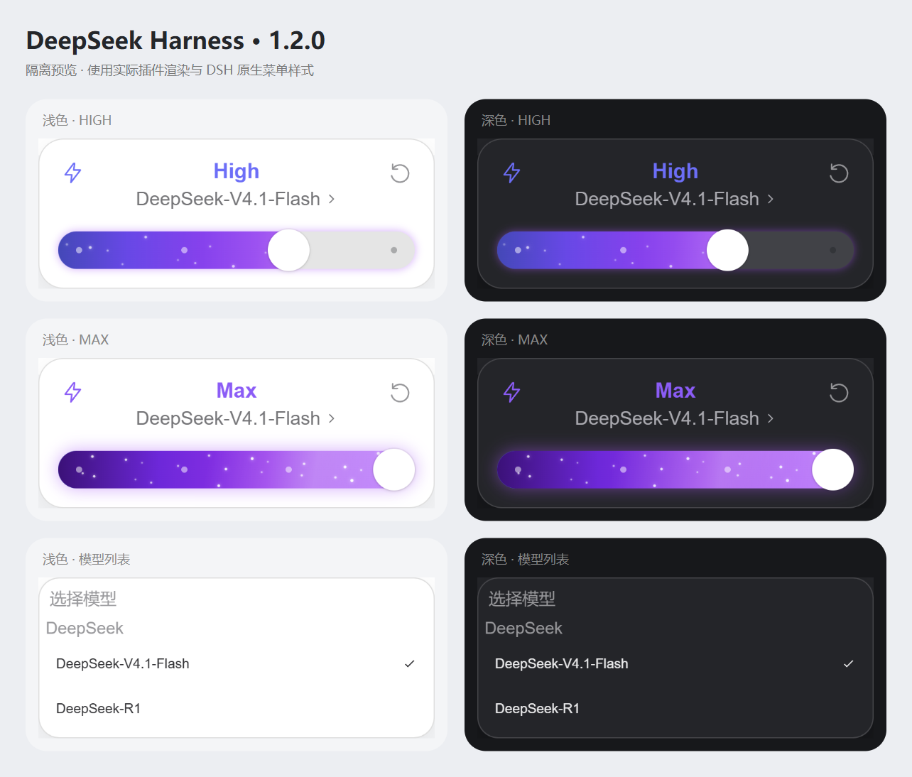

# dsh-codex-ui 1.2.0

DeepSeek Harness 的 Codex 风格模型与推理等级弹窗。独立发行名为 `dsh-codex-ui`，基于 [Microqian2th/dsh-codex-effort-slider](https://github.com/Microqian2th/dsh-codex-effort-slider) 的 `d1bb67b20bc19d44be7d7694ffca92a6f2fcbe9b`（1.1.2）修改。上游版权与 MIT 许可证完整保留，见 [THIRD_PARTY_NOTICES.md](THIRD_PARTY_NOTICES.md)。



## 三种原生安装方式

在 DSH「插件」页选择「安装第三方插件」，按来源填入以下任一项。三种方式安装的是同一个插件，选择一种即可。首次公开发布状态与维护者操作见 [PUBLISHING.md](PUBLISHING.md)。

| 来源 | 输入内容 |
| --- | --- |
| npm | `dsh-codex-ui@1.2.0` |
| Git 仓库 | `https://github.com/chadqian2012-sudo/dsh-codex-ui.git#v1.2.0` |
| 本地目录 | 解压后包含 `package.json` 的文件夹绝对路径 |

npm 下载源优先选择「npm 官方源」`https://registry.npmjs.org/`；需要时可选择镜像源 `https://registry.npmmirror.com/`，新版本可能尚未同步。Git 和本地目录来源无需配置 npm 包的下载源。本仓库的 `.npmrc` 仅为当前项目指定官方源，不改变全局配置。

**已有旧版 `dsh-codex-effort-slider` 时，先在 DSH 插件页卸载旧版，再安装此独立发行版。** 两个插件装饰同一个菜单，应只保留一个启用。安装器也会拒绝在旧版仍注册时叠加安装。更新同名第三方插件时，当前 DSH 要求先卸载再安装；先结束当前推理，再按 DSH 的提示重新启动。具体步骤、CLI 和离线回滚见 [INSTALL.md](INSTALL.md)。

## 界面与星尘

- 单一圆角卡片：顶部档位、居中模型名称、底部滑块；36px 轨道、40px 圆形旋钮。
- 模型列表使用 DSH 真实名称、版本、分组和原生选择事件。
- 左侧闪电显示推理状态；右侧重置由 DSH 解析当前模型的默认 effort。
- DeepSeek 四档 `off / low / high / max` 等距排列：off 灰色、low 蓝色，high 启用流光和星尘，max 更密、更快。
- 保留原滑块运动引擎与完整／简洁／快速动画模式，右键滑条可打开原有设置。

星尘采用每组件独立的积分相位时钟。变速影响后续位移，切换档位时不会重新排列星星；保留确定性分布、亮度与速度差，避免逐帧 React 重渲染。关闭弹窗或卸载时停止帧循环。旧版滑条偏好键沿用，因此迁移后可保留同一浏览器配置中的动画偏好。

## 会话边界与兼容性

宿主入口仅检查客户端产物；客户端只装饰当前 composer 通过 `aria-controls` 关联的模型菜单。模型和 effort 在用户操作控件后通过官方模型目录接口更新。没有消息注入、会话事件钩子、提示词改写、请求拦截或模型适配器修改。目录不可用或菜单结构不匹配时保留原生界面；不同会话使用各自的缓存、提交队列与粒子相位。

目标运行时为 DSH `0.2.1-rc.2`，声明范围 `>=0.2.1-rc.2 <0.3.0`。支持 Desktop 与 Web；界面依赖宿主的模型菜单契约。源码已包含 `lib/` 产物，npm、Git、本地安装均无需编译，也没有安装生命周期脚本或运行时依赖。

## 开发与验证

需要 Node.js 22 或更高版本。开发依赖只用于测试，不进入运行时依赖树。

```powershell
npm ci --ignore-scripts
npm test
npm run test:distribution
npm run test:install
npm run test:publish
npm run test:native
npm run test:browser
npm run preview
npm run pack
```

基础测试与发行工件测试不需要 DSH 或模型账号。`test:native`、`test:browser` 和预览读取本机 DSH 的官方 CSS／菜单契约；可用 `DSH_APP_ASAR` 指定 `app.asar`，用 `BROWSER_EXECUTABLE` 指定 Chromium 程序。浏览器目录替身不连接真实会话或调用模型。完整验证范围见 [VALIDATION.md](VALIDATION.md)。

## English

Codex-style model and effort menus for DeepSeek Harness, distributed independently as `dsh-codex-ui`. Install the npm package, a tagged Git repository, or an absolute local package directory through DSH's native third-party plugin dialog. Remove the upstream `dsh-codex-effort-slider` first; keep only one menu decorator enabled. The package ships prebuilt JavaScript with no runtime dependencies or install scripts. Native model selection, four DeepSeek effort levels, model-default reset, light/dark themes and phase-continuous stardust are preserved. Original MIT copyright and attribution are retained.
